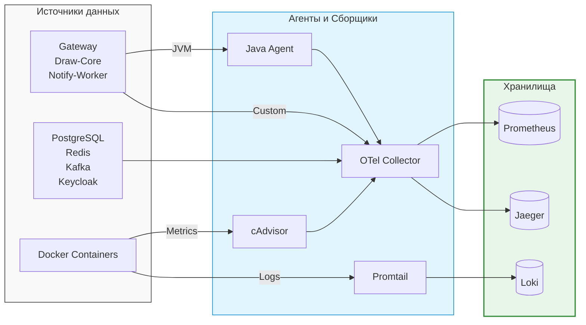
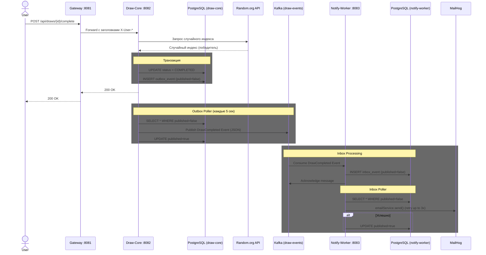
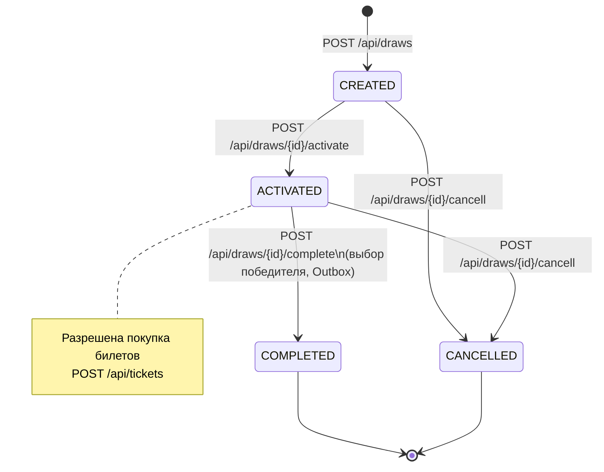
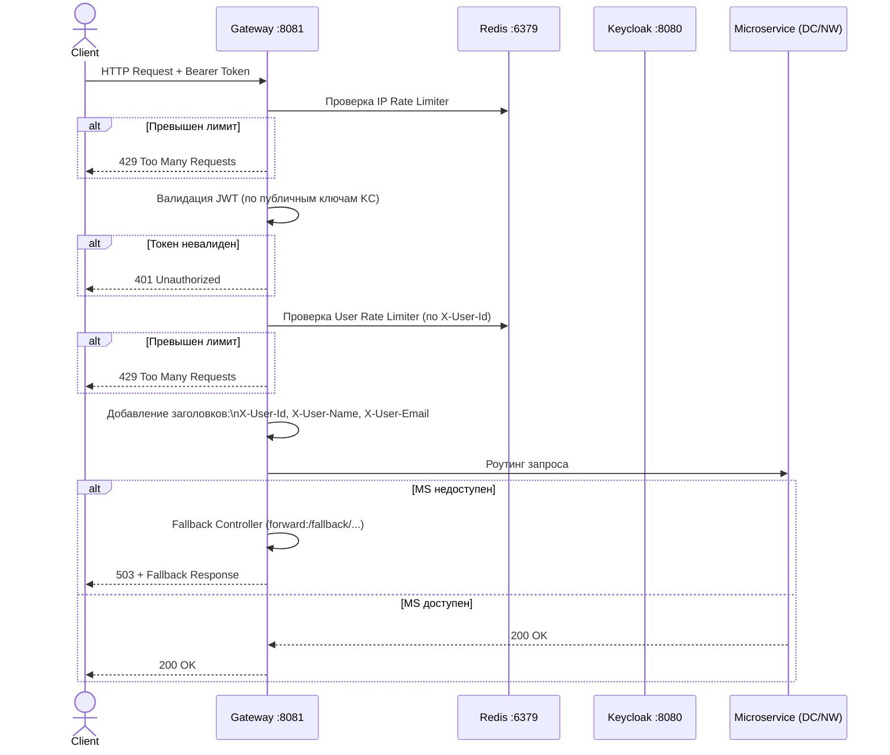

# Оглавление

- [Описание проекта](./../README.md)
- [Описание сервисов](./info.md)

### Архитектура приложения
*Общая схема взаимодействия микросервисов, внешней инфраструктуры и стека наблюдаемости. Отображает используемые порты, базы данных и основные потоки данных (бизнес-логика, метрики, логи).*

```mermaid
graph TB
    subgraph Services["Микросервисные сервисы"]
        Keycloak["keycloak:8080"]
        Gateway["gateway:8081"]
        DrawCore["draw-core:8082"]
        NotifyWorker["notify-worker:8083"]
    end

    subgraph Infrastructure["Инфраструктура"]
        PostgresDrawCore[("postgres:5432<br/>db:draw-core")]
        PostgresNotifyWorker[("postgres:5432<br/>db:notify-worker")]
        Redis[("redis:6379")]
        Kafka["kafka:9092"]
        Mailhog["mailhog:1025,8025"]
    end

    subgraph Observability["Observability стек"]
        OtelCollector["otel-collector<br/>8888,4317,4318"]
        Prometheus["prometheus:9090"]
        Jaeger["jaeger:16686,14250"]
        Loki["loki:3100"]
        Grafana["grafana:3000"]
        Promtail["promtail"]
        Cadviser["cAdvisor:8025"]
    end

    subgraph ExternalServices["Внешние сервисы"]
        RandomOrg["randomOrg API"]
    end

    %% Requests
    Gateway -->|token validation| Keycloak
    DrawCore -->|public keys| Keycloak
    NotifyWorker -->|public keys| Keycloak

    %% Rate limiting & storage
    Gateway -->|rate limits| Redis

    %% Data storage
    DrawCore -->|draws, tickets, outbox| PostgresDrawCore
    NotifyWorker -->|inbox events| PostgresNotifyWorker

    %% Event streaming
    DrawCore -->|draw-events| Kafka
    NotifyWorker -->|subscribes draw-events| Kafka
    NotifyWorker -->|send email| Mailhog

    %% External API
    DrawCore -->|random selection| RandomOrg

    %% Metrics: JVM + Custom
    Gateway -->|metrics via javaagent| OtelCollector
    DrawCore -->|metrics via javaagent| OtelCollector
    NotifyWorker -->|metrics via javaagent| OtelCollector

    %% Metrics: Services
    PostgresDrawCore -->|metrics| OtelCollector
    PostgresNotifyWorker -->|metrics| OtelCollector
    Redis -->|metrics| OtelCollector
    Kafka -->|metrics| OtelCollector
    Keycloak -->|metrics| OtelCollector

    %% Container metrics
    Cadviser -->|container metrics| OtelCollector

    %% Metrics to storage
    OtelCollector -->|store metrics| Prometheus

    %% Traces
    Gateway -->|traces| OtelCollector
    DrawCore -->|traces| OtelCollector
    NotifyWorker -->|traces| OtelCollector
    OtelCollector -->|store traces| Jaeger

    %% Logs
    Promtail -->|collect logs| Loki

    %% Dashboards
    Grafana -->|metrics| Prometheus
    Grafana -->|traces| Jaeger
    Grafana -->|logs| Loki

    classDef service stroke:#818cf8,fill:#696969
    classDef database stroke:#4ade80,fill:#696969
    classDef queue stroke:#fb923c,fill:#696969
    classDef observability stroke:#a78bfa,fill:#696969
    classDef external stroke:#f87171,fill:#696969
    classDef keycloak stroke:#22d3ee,fill:#696969

    class Gateway,DrawCore,NotifyWorker service
    class PostgresDrawCore,PostgresNotifyWorker,Redis database
    class Kafka,Mailhog queue
    class OtelCollector,Prometheus,Jaeger,Loki,Grafana,Promtail,Cadviser observability
    class RandomOrg external
    class Keycloak keycloak
```

### Observability
*Упрощенная схема пайплайнов сбора данных. Наглядно показывает три главных потока: откуда (Sources), через какие агенты (Agents) и в какие хранилища (Storage) попадают метрики, логи и трейсы.*

### Последовательность завершения розыгрыша (Outbox / Inbox Pattern)
*Детальный процесс завершения розыгрыша. Демонстрирует гарантированную доставку события о победителе через паттерн Outbox (в Draw-Core) и надежную обработку с повторными попытками отправки email через паттерн Inbox (в Notify-Worker).*

### Конечный автомат статусов розыгрыша (State Diagram)
*Жизненный цикл сущности "Розыгрыш". Отражает строго допустимые переходы между статусами и API-эндпоинты, которые эти переходы инициируют.*

### Поток аутентификации и маршрутизации в Gateway
*Алгоритм обработки входящего HTTP-запроса. Включает каскадные проверки rate limiting (по IP и User ID), валидацию JWT, обогащение запроса заголовками и fallback-механизм на случай недоступности целевого микросервиса.*

